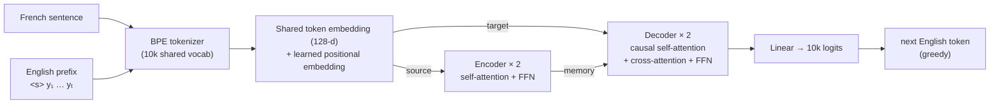
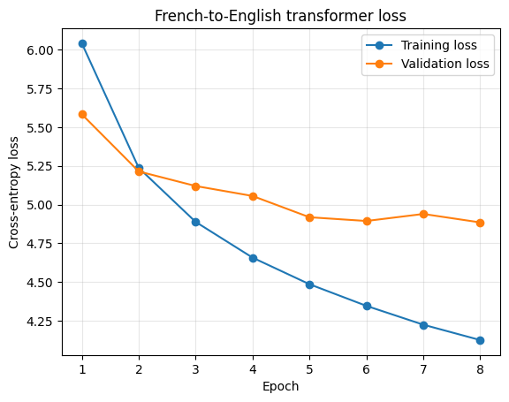

# French → English Neural Machine Translation with a From-Scratch Transformer

> An encoder-decoder Transformer built on PyTorch's `nn.Transformer` and trained from random initialization on 16k sentence pairs, with a custom BPE tokenizer, padding and causal masks, greedy decoding, a reloadable checkpoint, GPU-memory inspection, and corpus-level BLEU. It also includes a word-vector analogy experiment with spaCy.


## At a glance

| | |
|---|---|
| **Task** | French → English sentence translation |
| **Data** | 20,000 pairs sampled (seed 42) from [`Helsinki-NLP/opus_books`](https://huggingface.co/datasets/Helsinki-NLP/opus_books) en-fr → **16,200 train / 1,800 validation / 2,000 test** |
| **Tokenizer** | Byte-pair encoding trained on the training split only; shared 10,000-token FR+EN vocabulary; `<pad> <unk> <s> </s>`; max length 40 |
| **Model** | `nn.Transformer`, d_model 128, 4 heads, **2 encoder + 2 decoder layers**, FFN 2048, dropout 0.1, learned positional embeddings, shared source/target token embedding |
| **Training** | 8 epochs, batch 64, NAdam, cross-entropy with `ignore_index=<pad>`, teacher forcing |
| **Result** | Validation token accuracy **15.8% → 22.1%**; test **BLEU 1.32** on all 2,000 sentences |

## Architecture



**Masking.** Three masks are built explicitly: a source key-padding mask (applied to encoder self-attention *and* decoder cross-attention via `memory_key_padding_mask`), a target key-padding mask, and an upper-triangular causal mask so position *t* can only attend to positions ≤ *t*. Targets are shifted by one (`<s> y₁…yₙ` in, `y₁…yₙ </s>` out), and padding is excluded from both the loss and the token-accuracy metric.

## Results

### Training curve



| Epoch | 1 | 2 | 3 | 4 | 5 | 6 | 7 | 8 |
|---|---:|---:|---:|---:|---:|---:|---:|---:|
| Train loss | 6.043 | 5.237 | 4.888 | 4.657 | 4.485 | 4.345 | 4.224 | 4.124 |
| Valid loss | 5.584 | 5.214 | 5.120 | 5.056 | 4.918 | 4.894 | 4.939 | 4.885 |
| Valid token acc. | 15.77% | 18.10% | 18.38% | 18.80% | 21.25% | 21.47% | 21.24% | 22.12% |

Validation loss improves slowly after epoch 5 (4.918 → 4.885) while training loss keeps falling, so the train/validation gap widens. Validation loss and accuracy were both still at their best in the final epoch, so a longer run would likely help somewhat.

### Held-out translations

| French (test) | Reference | This model | Google Translate |
|---|---|---|---|
| Julien salua avec respect. | Julien made a respectful bow. | The young man was not a man . | Julien greeted with respect. |
| —Taisez-vous donc, nom de Dieu!… | "For God's sake, silence! | " Well , you are right , you ?" | —Shut your mouth, for God’s sake!… |
| Certes, le gouvernement faisait beaucoup, mais, pas assez! | Certainly the Government was doing much, but not enough. | As he went on , " Well , he will be done !" | Admittedly, the government was doing a lot—but not enough! |
| En ce moment, Cyrus Smith avait en tête d'autres pensées. | At this moment Cyrus Harding had other thoughts. | At last he was fully convinced , he had to be seen . | At that moment, Cyrus Smith had other thoughts on his mind. |

### BLEU (sacreBLEU, corpus level)

| Evaluation set | BLEU |
|---|---:|
| First 50 test sentences | 1.77 |
| **All 2,000 test sentences** | **1.32** |

**Honest read:** in the sampled outputs, the model produces English-looking sentences with plausible punctuation and quoting, but it does not carry over the French meaning. BLEU confirms this. That is the expected outcome for a 2-layer, 128-d Transformer trained from scratch for 8 epochs on 16k literary sentence pairs. Production NMT systems train on tens of millions of pairs. The value of this project is that the full pipeline (tokenization, masking, teacher forcing, decoding, checkpointing, evaluation) runs end to end and gives a working base for the improvements listed below.

### GPU memory inspection

After training, the notebook walks Python's garbage collector and finds **136 CUDA tensors** (38.76 MiB in total; shape, dtype, and size for each), then releases the model and clears the cache:

| | Before cleanup | After cleanup |
|---|---:|---:|
| `torch.cuda.memory_allocated` | 56.01 MiB | 17.25 MiB |
| `torch.cuda.memory_reserved` | 814.00 MiB | 118.00 MiB |

The largest entries are four vocabulary-sized 10,000 × 128 float32 tensors (4.88 MiB each), followed by the 128 × 2048 feed-forward weights (1.00 MiB each).

### Bonus: word-vector arithmetic

`vec("prince") − vec("man") + vec("woman")` with spaCy's 300-d `en_core_web_md` vectors, input words excluded:

| Rank | Word | Cosine similarity |
|---:|---|---:|
| 1–3 | hairdresser, gal, actress | 0.7345 (tied) |
| 4–5 | stunner, starlet | 0.6850 (tied) |

The textbook answer, "princess", does not appear, and the exact ties occur because spaCy's medium model maps many words onto **shared vector rows**. The analogy therefore recovers the *female* direction but blurs royalty, and the neighbors also reflect gender stereotypes.

## Repository structure

```text
english-french-transformer/
├── README.md
├── requirements.txt
├── notebooks/
│   └── french_to_english_transformer.ipynb   # all four parts, outputs saved
└── images/
    └── training_loss.png
```

## How to run

```bash
git clone https://github.com/reidsendroff/english-french-transformer.git
cd english-french-transformer
python -m venv .venv && source .venv/bin/activate
pip install -r requirements.txt
python -m spacy download en_core_web_md
jupyter lab notebooks/french_to_english_transformer.ipynb
```

Run the cells top to bottom: part 4 reloads the checkpoint and tokenizer that part 2 writes to `assign07_artifacts/` (git-ignored). A CUDA GPU is recommended.

## What I would do next

1. **Scale data before model size:** use the full 127k opus_books pairs, then add a larger corpus (Europarl or WMT14 en-fr).
2. **Learning-rate warmup + inverse-sqrt decay and label smoothing (0.1)**, as in *Attention Is All You Need*.
3. **Beam search** (width 4–5) with length normalization instead of greedy decoding.
4. **Faster decoding:** greedy decoding currently re-runs the full encoder and decoder for every generated token. Encode once and cache decoder keys and values.
5. Track **chrF** and **COMET** alongside BLEU, since BLEU is unreliable at very low scores.

## Skills demonstrated

**NLP / deep learning:** Transformer encoder-decoder, multi-head and cross-attention, causal and padding masks, teacher forcing, BPE subword tokenization, autoregressive decoding, BLEU evaluation, word embeddings.
**Engineering:** Hugging Face `datasets` + `tokenizers`, custom `collate_fn`, model and config checkpointing, then reloading the checkpoint for evaluation, CUDA memory profiling, reproducible seeds and splits.

## Context

Built by **Reid Sendroff** ([LinkedIn](https://www.linkedin.com/in/reidsendroff)) for Harvard Extension School's graduate **CSCI E-89 Deep Learning** course (2026).
